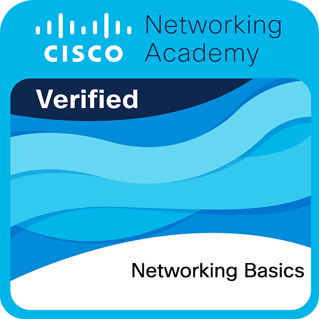
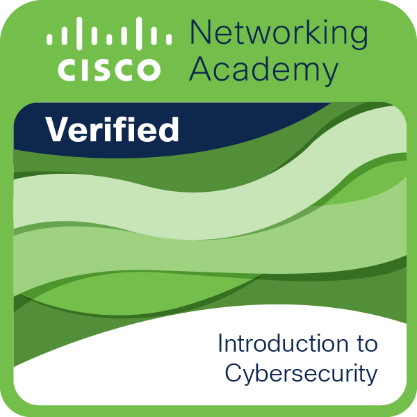
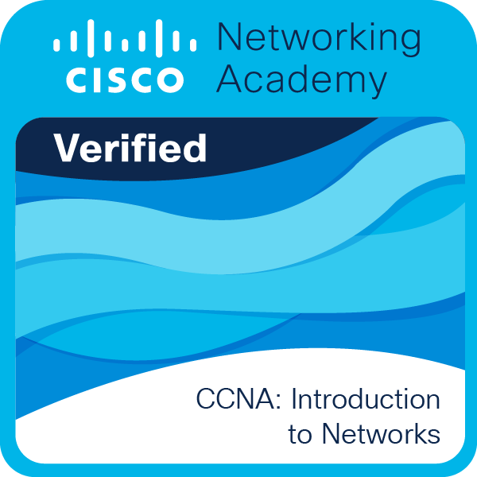
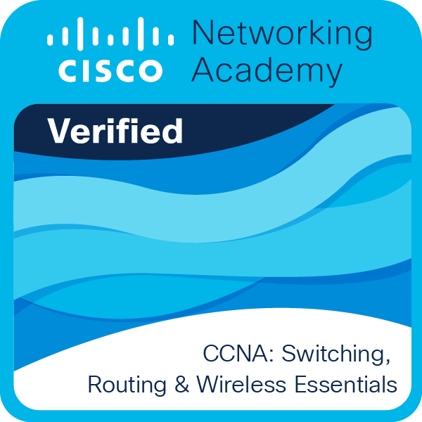
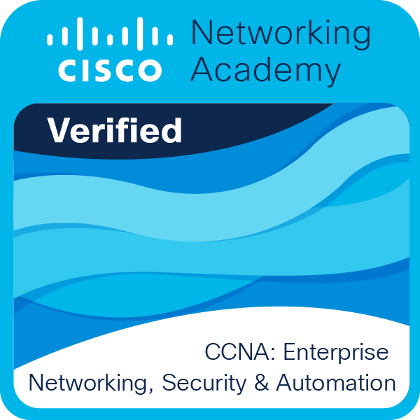
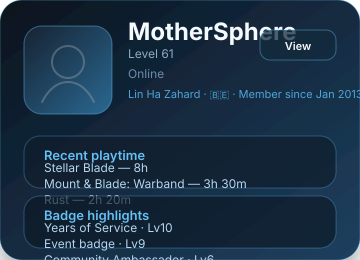

<div align="center">
  
  <br>
  
  <p>
    I write desktop apps and game mods, mostly in Rust, on Arch Linux with Hyprland.<br>
    The apps live in <a href="https://github.com/Project-Colony">Project Colony</a>, the mods and one-off tools on this account.
  </p>

[](https://x.com/MotherSphere)
[](https://discord.com/users/503306069884534796)
[](https://steamcommunity.com/id/lopobia)
[](https://github.com/Project-Colony)


</div>

## About me

```zsh
┌─[MotherSphere@Colony] - [~]
└─>[$] neofetch

        ____________________________         MotherSphere@Colony
       /__________________________/|         -------------------
      |   COLONY // CORE MODULE   | |        OS:         Colony
      |   ┌────────────────────┐  | |        Host:       Mother Sphere
      |   │   MOTHER SPHERE    │  | |        Kernel:     Arch Linux - Colony ver.
      |   │      [  MS  ]      │  | |        WM:         Hyprland
      |   └────────────────────┘  | |        Status:     Wandering the Colony
      |___________________________|/         Terminal:   GitHub Computer
             |   |   |                       Focus:      Rust desktop apps + game mods
             |___|___|                       Knowledge:  Rust + C++ + Python + TypeScript
                                             Modules:    Colony, Eidos, Raven, Grape
                                             Org:        github.com/Project-Colony
```

## Projects

### Project Colony

| Project | What it is |
|---|---|
| [Raven](https://github.com/Project-Colony/Raven) | Runs Windows programs on Linux against a real Windows installation mounted as `C:`, with Wine at the syscall layer. |
| [Eidos](https://github.com/Project-Colony/Eidos) | Mod manager for Linux with its own virtual filesystem (FUSE and namespaces), written to replace MO2 and usvfs under Wine. |
| [Colony](https://github.com/Project-Colony/Colony) | Launcher and app store that installs, updates and starts the Colony apps. Self-updates are signed. |
| [Colony Firewall Control](https://github.com/Project-Colony/Colony-Firewall-Control) | Per-application outbound firewall for Linux, ported from OpenSnitch to Rust. |
| [Grape](https://github.com/Project-Colony/Grape) | Music player that uses your music folder as the library. |

### Games and modding

| Project | What it is |
|---|---|
| [NIKKE-Launcher-Check](https://github.com/MotherSphere/NIKKE-Launcher-Check) | Read-only check for traces of the November 2026 NIKKE PC launcher compromise, on Windows, Linux (Proton, Steam Deck) and macOS. |
| [Colony-Camera](https://github.com/MotherSphere/Colony-Camera) | Third-person camera plugin for Skyrim, in Rust and C++ on CommonLibSSE-NG. |
| [stellar-blade-coop](https://github.com/MotherSphere/stellar-blade-coop) | Experimental co-op mod for Stellar Blade, built on UE4SS and a Steam connection between the two games. |

## Stack

<a href="https://skillicons.dev">
  
</a>

Cisco Networking Academy badges:

<p>
  
  
  
  
  
</p>

## Discord and Steam

<p align="center">
  <a href="https://discord.com/users/503306069884534796">
    
  </a>
  <!-- Steam showcase generated via scripts/update_steam_showcase.py -->
  <!-- Refresh with: python3 scripts/update_steam_showcase.py --vanity <steam-vanity> --cache data/steam-profile-cache.json -->
  <a href="https://steamcommunity.com/id/lopobia">
    
  </a>
</p>

## On repeat

<table>
  <tr>
    <td align="center" width="33%">
      <a href="https://youtu.be/4biZQR2ov0s"></a><br>
      <sub>Lily's Atelier · Stellar Blade</sub>
    </td>
    <td align="center" width="33%">
      <a href="https://youtu.be/UZGUqbyKwO8"></a><br>
      <sub>The Song of the Wanderer · Stellar Blade</sub>
    </td>
    <td align="center" width="33%">
      <a href="https://youtu.be/2L3OCqW76hE"></a><br>
      <sub>Dawn in the Adan · Ichiko Aoba</sub>
    </td>
  </tr>
  <tr>
    <td align="center" width="33%">
      <a href="https://youtu.be/AT5fDDKWMok"></a><br>
      <sub>17 Sekibetsu · GATE</sub>
    </td>
    <td align="center" width="33%">
      <a href="https://youtu.be/zdIc3CHvmzo"></a><br>
      <sub>Pulse · Wu Yun Ta Na</sub>
    </td>
    <td align="center" width="33%">
      <a href="https://youtu.be/DgHZV4lbDpY"></a><br>
      <sub>Awakening · Ender Lilies</sub>
    </td>
  </tr>
</table>

## GitHub stats

<p align="center">
  
  
  
  
</p>

<div align="center">
  
  <p>Thanks for reading.</p>
</div>
